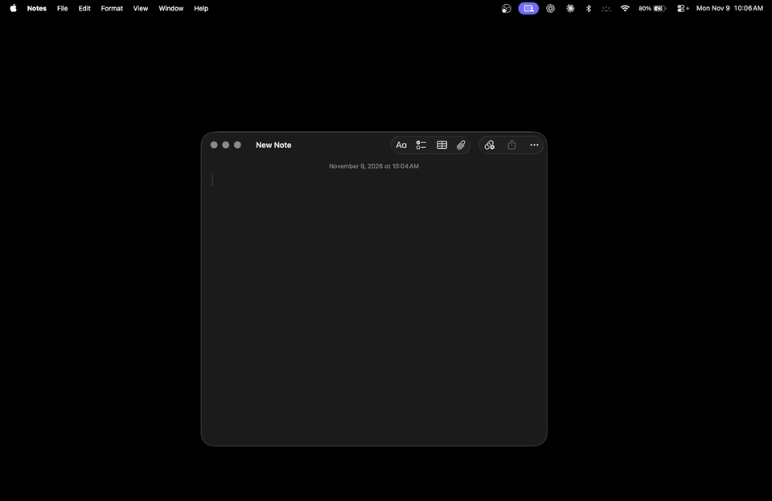

<h1 align="center">
  
</h1>

<p align="center">
  
  
  
  
</p>

<p align="center">
  <a href="#preview">Preview</a> ·
  <a href="#setup">Setup</a> ·
  <a href="#running">Running</a> ·
  <a href="#how-it-works">How it works</a> ·
  <a href="docs/ARCHITECTURE.md">Architecture</a> ·
  <a href="#credits">Credits</a>
</p>

<br>

Eclipse is a desktop app that sits between your screen and OBS. It reads the screen, covers secrets with solid black boxes, and sends the result to OBS as a virtual camera, one second behind live. It covers emails, phone numbers, 2FA codes, API keys, card numbers and your own keywords. A frame that hasn't been scanned never goes out. Built for natHacks 2026 (Standard Division, Defense & Security).

## Preview

<p align="center">
  
</p>

What viewers see through Eclipse: the note's username and password stay covered while the window moves.

## Setup

You need Python 3.11 and OBS 30 or later.

```bash
python3.11 -m venv .venv
source .venv/bin/activate
pip install -r requirements.txt
```

### macOS, once per laptop

1. In System Settings → Privacy & Security, allow Screen Recording for whatever runs Python (Terminal, iTerm or VS Code). Allow Input Monitoring too if you want the panic key.
2. In OBS, start and stop the virtual camera once, and approve the camera extension when macOS asks.
3. In OBS, set Settings → Video → Common FPS Values to 60, then add a Video Capture Device source and pick OBS Virtual Camera.

## Running

Run Eclipse as a module from the repo root:

```bash
python -m eclipse.main
```

On Windows, run this in PowerShell after installing the requirements:

```powershell
.\.venv\Scripts\python.exe -m eclipse.main --ocr windows --capture mss --fps 15 --max-width 1920 --delay 1 --no-panel --no-hotkey
```

This command runs without the panel and panic shortcut. Ctrl+C stops it.

The default command uses RapidOCR at 60 fps with a 1-second delay. While it runs:

- Open the **Open authorized panel** link printed in the terminal. Turn categories on or off, add keywords, see what was caught, and panic or resume. Each launch generates a new private token; after restarting Eclipse, open the new link. The browser removes the token from the address bar and keeps it for refreshes in that tab. Do not share the launch link or include it in demo recordings. Opening the plain localhost URL in a new tab does not authorize controls.
- Control+Option+B blacks out the output, including frames already waiting to go out. Resume from the panel.
- Numbers (never screen text) go to `eclipse-run.log` every 2 seconds.
- Ctrl+C stops it. The last frame sent is black.

Useful options:

| Option | What it does |
| --- | --- |
| `--ocr apple` | Use Apple's built-in OCR. Much faster, but finds fewer secrets than RapidOCR. |
| `--ocr windows` | Use Windows' built-in OCR, on the device. |
| `--fps 30` | Capture and send at a different frame rate |
| `--delay 2` | Seconds behind live |
| `--cover blur` | Blur covers instead of solid black. The blur is made only from the colours around each cover, never the pixels under it, and hides exactly the same areas. Switch live with the panel's Black bar style toggle |
| `--test-pattern` | Send a moving pattern with a fake secret instead of your screen, to check OBS |
| `--no-output` | Do all the work but send nothing, for timing runs |

`python -m eclipse.main --help` lists the rest.

Don't run `python eclipse/main.py`. That puts the package folder on Python's import path, where our `platform.py` hides the standard library module of the same name.

To debug with the same input every time, play a recorded clip through the live pipeline instead of the screen. It plays at the clip's own speed and stops when the clip ends:

```bash
python -m eclipse.main --clip eval/clips/planted_secrets.mp4
```

Add `--loop` to replay it, and `--clip-source webcam` or `--clip-source irl` to tag its frames as that source.

To stream the screen and a webcam together, add the camera's index. It goes in the bottom right corner, a quarter of the screen's width (change that with `--pip-size 0.3`):

```bash
python -m eclipse.main --with-webcam 0
```

The screen and the camera are each scanned on their own, side by side, and joined only after both are covered. A face moving in the corner never makes the screen be read again, and a camera picture that hasn't changed since the last frame isn't read at all. A video file path in place of the index stands in for the camera, looped, and it works with `--clip` too.

With `--with-webcam`, you can switch live between three views: `screen`, `both` (the default) and `webcam` (the camera alone, full size). Start on another one with `--view screen`. To switch:

- Press Ctrl+Alt+V to step through screen, both, webcam and round again.
- Or, for the panel, call `PUT /api/view` with `{"view": "screen" | "both" | "webcam"}`. It returns the panel state. `GET /api/state` reports `view` (the current one) and `views` (the ones this run can switch to). A run without a webcam reports `null` and `[]`, and `PUT /api/view` returns 409.

Both inputs keep running in every view, so a switch takes effect on the next frame. A switch that adds a source (screen → both) just shows up after the usual delay. A switch that drops one (both → screen, or anything → webcam) cuts the output at once: black goes out for about the delay (1 s by default) until the new view's first checked frame arrives, so nothing of the dropped source is shown after the switch.

If the camera's scan falls behind, the screen doesn't wait for it. The corner keeps the last camera picture that was checked, with its covers, so only the corner slows down. The screen waits only if that picture would be more than half a second behind.

Run the tests with:

```bash
python -m pytest
```

Measure leaks and latency on the test clips with:

```bash
python -m eval.run_eval
```

## How it works

Capture, scanning and output run side by side. Each frame is read with OCR, checked against the rules, and covered before it reaches the delay buffer, and a gate checks every picture on its way out. Panic works at that gate, so it takes effect at once, however far behind the scanner is. See [docs/ARCHITECTURE.md](docs/ARCHITECTURE.md) for each module and the other eval scripts.

## Layout

```text
eclipse/    the app: capture, text_detect, compositor, output, panel
eval/       test clips, ground-truth labels and the eval scripts
tests/      unit tests
docs/       architecture
```

Test clips use planted fake secrets and clues only. Never commit a real secret or address, even for testing.

## Credits

- Eclipse was made by: Max, Manan Singh, Ian Lartey, Owen 

- Secret rules are inspired by [gitleaks](https://github.com/gitleaks/gitleaks) patterns.
- OCR by [RapidOCR](https://github.com/RapidAI/RapidOCR), and Apple's Vision framework through [PyObjC](https://github.com/ronaldoussoren/pyobjc).
- Screen capture through ScreenCaptureKit (PyObjC) and [mss](https://github.com/BoboTiG/python-mss), image work with [OpenCV](https://opencv.org/).
- Virtual camera output through [pyvirtualcam](https://github.com/letmaik/pyvirtualcam) and [OBS](https://obsproject.com/).
- Control panel with [FastAPI](https://fastapi.tiangolo.com/) and [Uvicorn](https://www.uvicorn.org/), panic key with [pynput](https://github.com/moses-palmer/pynput).

We used AI tools, including Claude Code and ChatGPT, during planning and development.
